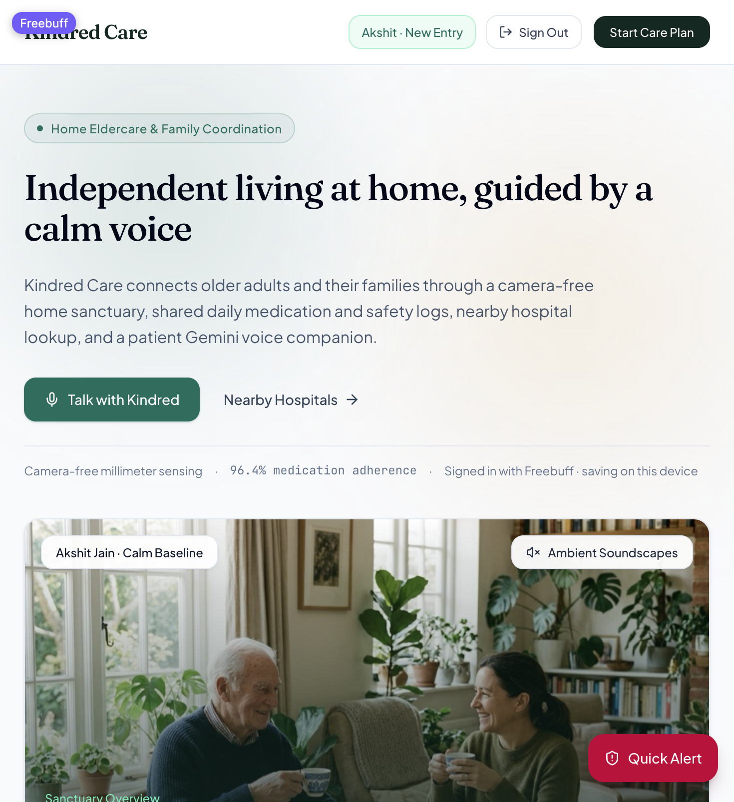
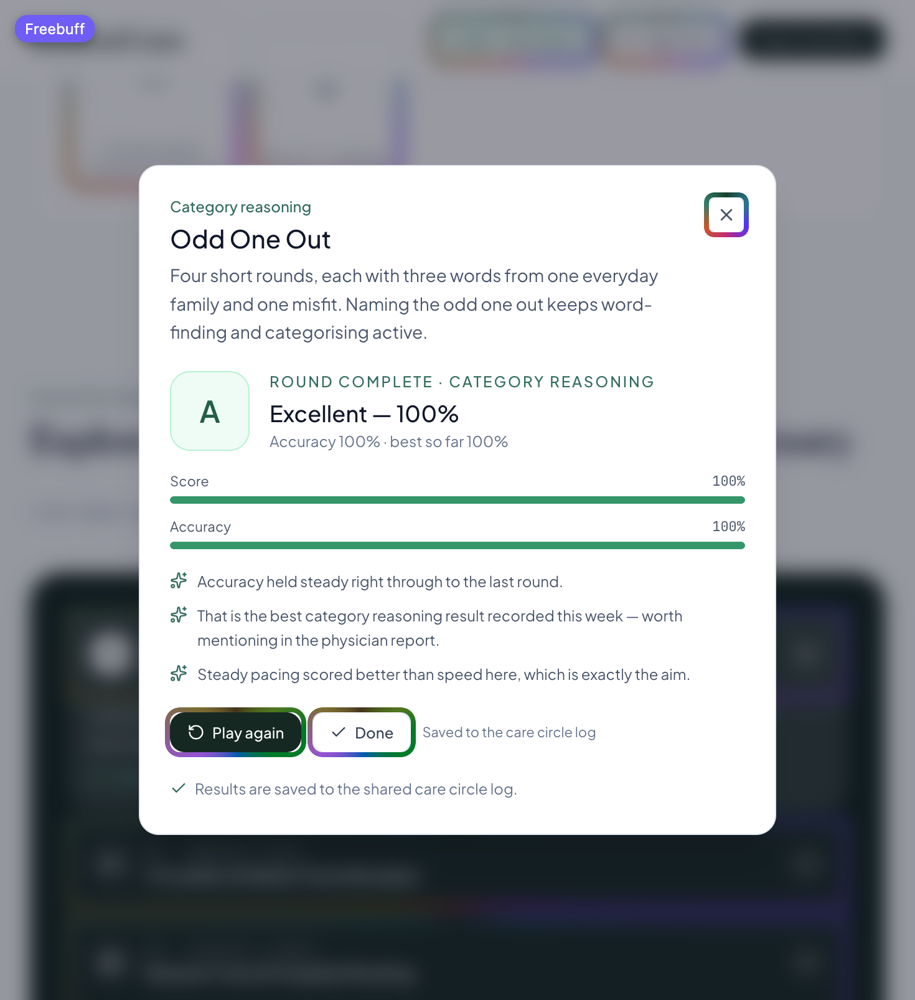
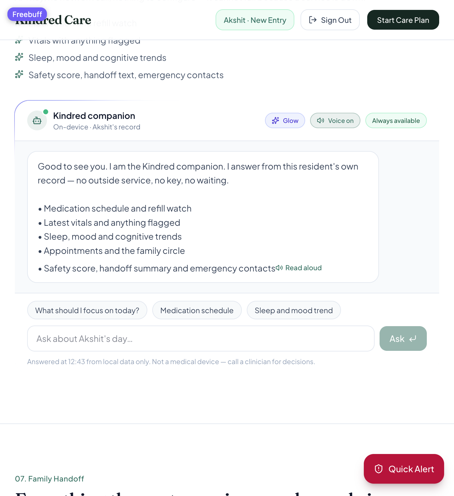

# Kindred Care

A calm, camera-free eldercare coordination app for older adults and the families who look after them. Everything a care circle needs in one place: a shared daily rhythm, sleep and medication logs, nine gentle cognitive exercises, vitals and mood tracking, family handoff notes, and an on-device care assistant that answers questions from the resident's own record.

Built with React 19, TypeScript, Tailwind CSS 4 and Motion, running as a static SPA plus a Cloudflare Worker, deployed on [Freebuff Sites](https://freebuff.com) with real "Sign in with Freebuff" (OIDC) authentication.

**Live preview:** https://site-f5d231c483354fe0b0e0b0bc37991057.freebuff.page



## Features

### Shared care circle
- Resident switcher, daily care tasks with completion state, hydration tracking with a goal, shared notes, and an ambient sensor/security log.
- **People around the resident** — a hover/focus roster that reveals each circle member's name with a kinetic per-letter animation and a cursor follower.

### Sleep & cognition
- **Sleep journal** — hours, quality, caregiver and observation, with a dual-axis chart (hours as bars, quality as a line) and recent nights.
- **Nine cognitive games**, each with a **graded result screen** (A–D, score, accuracy, best-so-far and written analysis):
  Botanical Memory Pairs · Pattern Continuation · Sequence Echo · Odd One Out · Number Path · Word Recall · Colour Word · Everyday Sort · Steady Tap.
- Sessions are saved per resident and appended to the wellness history.



### Vitals, mood & safety
- Log blood pressure, pulse, SpO₂, weight or glucose with automatic Normal/Watch flagging.
- One-tap mood and energy check-in with a seven-day strip.
- Animated **safety score** computed from hydration, open tasks, sensor events, sleep, refills and mood.
- Today's medication timeline with take/skip toggles and an adherence bar.

### Family handoff & progress
- Appointment countdown, a shared family board, tap-to-call emergency contacts, and a **generated handoff note** with one-tap copy.
- Weekly rhythm report, earned badges, and a doctor visit prep checklist.

### Kindred companion
- A care assistant that answers **entirely on device** from the resident's medications, vitals, sleep, tasks, appointments, allergies and circle members. No API key, no network call, so it cannot fail because a service is down.
- Replies are **read aloud** with the Web Speech API, with a Voice on/off toggle and per-answer "Read aloud".



### Motion & accessibility
- Kinetic word-by-word headlines, 3D tilt cards, ambient aurora fields, a rotating gradient ring (Skiper-style) around every button, and a gradient frame around the assistant.
- Senior-readable font scaling and high-contrast mode, `prefers-reduced-motion` respected throughout.

### Authentication
- **Sign in with Freebuff** — standards-based OIDC with PKCE. The browser never sees tokens; the Worker issues an HttpOnly `__Host-freebuff_session` cookie, and `/api/*` routes require a session (401) and same-origin mutations (403).

## Tech stack

| Layer | Choice |
| --- | --- |
| UI | React 19, TypeScript, Tailwind CSS 4, lucide-react |
| Motion | `motion` (Framer Motion), CSS keyframes |
| Charts | Recharts |
| 3D / report PDF | three, jsPDF |
| SPA build | Vite 8 (rolldown) |
| Local server | Express + tsx (`server.ts`) |
| Production runtime | Cloudflare Worker (`worker/`) via Freebuff Sites |
| Auth | `@freebuff/auth` (OIDC, session cookie) |

## Getting started

Requires Node.js 20 or newer.

```bash
npm install --legacy-peer-deps
npm run dev            # http://localhost:3000  (override with PORT=8123)
```

`--legacy-peer-deps` is needed because Vite 8 declares a peer range the other tools have not caught up to yet.

### Scripts

| Command | What it does |
| --- | --- |
| `npm run dev` | Express + Vite dev server on `PORT` (default 3000) |
| `npm run build` | Build the SPA into `dist/` |
| `npm run build:worker` | Bundle `worker/index.ts` into `deploy/worker.js` (ESM, for Cloudflare) |
| `npm run lint` | `tsc --noEmit` type check |
| `npm run preview` | Preview the built SPA |

### Environment variables

All of these are **optional locally**. The app runs without any of them; only the noted features need them.

| Variable | Used by | Purpose |
| --- | --- | --- |
| `GEMINI_API_KEY` | Worker API routes | Gemini assistant/voice endpoints (the in-app assistant does not need it) |
| `GOOGLE_MAPS_API_KEY` | Worker API routes | Places lookup for the hospital proxy |
| `FREEBUFF_CLIENT_ID` | Worker + client | Injected automatically by Sites when auth is enabled |
| `FREEBUFF_ISSUER` | Worker + client | `https://freebuff.com/oidc` |
| `APP_ORIGIN` | Worker | The site's own origin; used for the callback and session cookie |

Copy `.env.example` to `.env` and fill in what you need. Never commit `.env` (it is git-ignored).

## Deploying

The production target is a Cloudflare Worker plus static assets, packaged for **Freebuff Sites**:

```bash
npm install --legacy-peer-deps
npm run build          # -> dist/
npm run build:worker   # -> deploy/worker.js
```

`deploy-manifest.json` already wires those two outputs together:

```json
{
  "entrypoint": "index.js",
  "compatibilityDate": "2026-11-01",
  "modules": [{ "name": "index.js", "type": "esm", "path": "./deploy/worker.js" }],
  "assetsDirectory": "./dist",
  "spa": true
}
```

Then publish with the Sites panel/CLI. Auth variables (`FREEBUFF_CLIENT_ID`, `FREEBUFF_ISSUER`, `APP_ORIGIN`) are injected on deploy once auth is enabled for the site, and any API keys go in the project's secret store rather than the repo.

Local Worker smoke test (no account needed):

```bash
npx wrangler dev --port 8787 --ip 127.0.0.1
```

## Project structure

```
src/
  App.tsx                     page composition, state, handlers
  components/                 UI sections and shared primitives
    CognitiveGames.tsx        9 games + graded result panel
    SleepTracker.tsx          sleep journal + chart
    HealthVitalsStudio.tsx    vitals, mood, safety gauge, medication timeline
    FamilyHandoffHub.tsx      appointments, board, contacts, handoff note
    CareProgressDigest.tsx    weekly report, badges, doctor prep
    KindredAssistant.tsx      on-device assistant UI (+ speech output)
    HoverMemberCircle.tsx     skiper6-style roster
    AppleGradientFrame.tsx    skiper86-style gradient frame
    SkiperKineticPrimitives.tsx, Motion3DPrimitives.tsx
  services/
    careAssistantEngine.ts    intent matching + answers from resident data
    wellnessExtras.ts         storage helpers and computed care metrics
    careStore.ts              device-local care state
  freebuffAuth.ts             OIDC helpers + session hook
  data/eldercareData.ts       types and seeded demo residents
worker/
  index.ts                    auth wrapper -> /api/* -> static assets
  api.ts                      API routes on Workers (health, places, Gemini, alerts)
server.ts                     Express host used by the dev server
```

## Data & privacy

- Care data lives in the browser (`localStorage`, keyed per resident, e.g. `kindred_sleep_journal_<residentId>`, `kindred_cognitive_sessions_<residentId>`, `kindred_vitals_<residentId>`, `kindred_board_<residentId>`).
- The assistant never sends data anywhere; answers are composed from the resident record already in the page.
- Authentication is a server-issued HttpOnly cookie; no tokens are stored in JavaScript or `localStorage`.

## Known limitations

- Voice *input* is not shipped: the Web Speech recognition API is unavailable in several Chromium builds (it starts and never emits an event), so the composer is type-only. Spoken output works.
- The Google Maps hospital locator and the hosted Gemini assistant were removed because they required API keys that were not provisioned; the Worker still exposes compatible routes for anyone who wants to re-enable them with their own keys.
- Care data is device-local by design in this build — it is not yet synchronised across devices.

## Acknowledgements

UI motion is inspired by [Skiper UI](https://skiper-ui.com) components (skiper6, skiper27, skiper80, skiper86), reimplemented here with this project's own primitives because those registry items are Pro-licensed.

## License

No license file is included yet. If you intend to publish this repository, add a `LICENSE` file — MIT is the common choice for a project like this — so others know what they may do with it.
# kindred-care1
